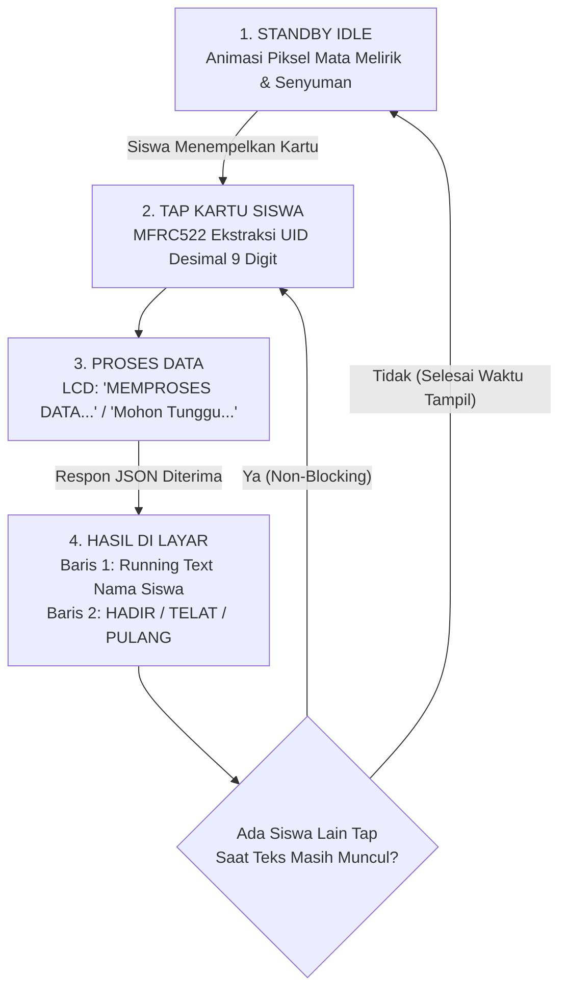

# Panduan Integrasi Hardware ESP32 + RFID MFRC522 + LCD 1602 I2C (SI-HADIR)
**SMK Ma'arif 1 Padang Ratu - Sistem Gerbang IoT Presensi & Poin Kedisiplinan**

Panduan teknis perakitan perangkat keras, wiring pin, instalasi library Arduino IDE, serta konfigurasi sketch firmware untuk mesin presensi mandiri berbasis ESP32.

---

## 1. Daftar Komponen Keras (Hardware)

| Komponen | Spesifikasi / Model | Jumlah | Fungsi / Keterangan |
| :--- | :--- | :---: | :--- |
| **Microcontroller** | ESP32-WROOM-32 (DevKit V1 30-Pin / 38-Pin) | 1 pcs | Pemroses utama dengan modul WiFi 2.4GHz & SPI |
| **RFID Scanner** | MFRC-522 (RC522) 13.56 MHz | 1 pcs | Pembaca kartu Mifare 1K / e-KTP / Kartu Pelajar RFID |
| **Buzzer Aktif** | KY-012 Active Buzzer Module | 1 pcs | Indikator audio nada beep (hadir, telat, ditolak) |
| **Layar LCD** | 1602 HD44780 (16 Karakter x 2 Baris) | 1 pcs | Layar visual status presensi, running text nama, & animasi mata |
| **Adaptor LCD** | Modul I2C / IIC Backpack (PCF8574) | 1 pcs | Penghemat pin ESP32 (hanya butuh 2 kabel I2C: SDA & SCL) |
| **Kabel Jumper** | Dupont Female-to-Female & Male-to-Female | 1 set | Penghubung pin antar modul |
| **Kabel Data USB** | Micro USB Data Cable | 1 pcs | Catu daya & upload program dari Arduino IDE |

---

## 2. Skema Wiring & Sambungan Pin Kabel

> [!CAUTION]
> **PERINGATAN TEGANGAN MFRC522:**
> VCC pin MFRC522 **WAJIB disambungkan ke pin 3.3V (3V3)** ESP32. Jangan pernah menghubungkannya ke 5V / VIN karena dapat merusak IC MFRC522 secara permanen!

### A. RFID Reader MFRC522 $\rightarrow$ ESP32 (Jalur SPI)
| Pin MFRC522 | Pin ESP32 (DevKit V1) | Keterangan / Jalur Sinyal |
| :--- | :--- | :--- |
| **3.3V / VCC** | **3V3** | Sumber tegangan 3.3 Volt (Wajib 3.3V) |
| **RST** | **GPIO 4 (D4)** | Pin Reset (Gunakan D4 agar D22 bebas untuk LCD I2C) |
| **GND** | **GND** | Ground bersama |
| **MISO** | **GPIO 19 (D19)** | SPI Master In Slave Out |
| **MOSI** | **GPIO 23 (D23)** | SPI Master Out Slave In |
| **SCK** | **GPIO 18 (D18)** | SPI Serial Clock |
| **SDA / SS** | **GPIO 5 (D5)** | SPI Slave Select / Chip Select |

### B. LCD 1602 + Modul I2C Backpack $\rightarrow$ ESP32 (Jalur I2C)
| Pin Modul I2C LCD | Pin ESP32 | Keterangan |
| :--- | :--- | :--- |
| **VCC** | **VIN / 5V** | Catu daya modul I2C dan backlight LCD (5V stabil) |
| **GND** | **GND** | Ground bersama |
| **SDA** | **GPIO 21 (D21)** | Jalur Data Serial I2C baku ESP32 |
| **SCL** | **GPIO 22 (D22)** | Jalur Clock Serial I2C baku ESP32 |

### C. Active Buzzer KY-012 $\rightarrow$ ESP32
| Pin Buzzer KY-012 | Pin ESP32 | Keterangan |
| :--- | :--- | :--- |
| **Pin S (Sinyal)** | **GPIO 13 (D13)** | Pemicu nada buzzer |
| **Pin - (GND)** | **GND** | Ground bersama |

---

## 3. Persiapan Arduino IDE & Download Library

1. Unduh dan pasang **Arduino IDE** (versi 2.x disarankan).
2. Tambahkan URL Board ESP32 jika belum terpasang:
   - Buka menu `File` $\rightarrow$ `Preferences`.
   - Pada kolom *Additional Boards Manager URLs*, tempel:
     ```text
     https://raw.githubusercontent.com/espressif/arduino-esp32/gh-pages/package_esp32_index.json
     ```
3. Buka menu `Tools` $\rightarrow$ `Board` $\rightarrow$ `Boards Manager...`, cari **esp32** oleh Espressif Systems lalu klik **Install**.
4. **Pasang Library Wajib lewat Library Manager:**
   - Buka menu `Tools` $\rightarrow$ `Manage Libraries...` (atau tekan `Ctrl + Shift + I`).
   - Cari **MFRC522** (oleh *GithubCommunity*) $\rightarrow$ klik **Install**.
   - Cari **LiquidCrystal I2C** (oleh *Frank de Brabander* atau *Marco Schwartz*) $\rightarrow$ klik **Install**.
   - *(Library `<WiFi.h>`, `<HTTPClient.h>`, `<SPI.h>`, dan `<Wire.h>` adalah library bawaan core ESP32, tidak perlu diunduh lagi).*

---

## 4. Bagian yang Wajib Disesuaikan di Kode Firmware

Buka sketch [`arduino/esp32_rfid_attendance.ino`](esp32_rfid_attendance.ino) pada Arduino IDE, lalu periksa 3 bagian berikut:

### 1. Nama & Password WiFi
Sesuaikan nama SSID dan sandi jaringan WiFi atau hotspot tempat ESP32 terhubung:
```cpp
const char* WIFI_SSID     = "NAMA_WIFI_KAMU";
const char* WIFI_PASSWORD = "PASSWORD_WIFI_KAMU";
```

### 2. Alamat Endpoint Server SI-HADIR
ESP32 mengirimkan request HTTP POST ke endpoint `/api/attendance`:
```cpp
// Jika uji coba lokal di laptop (Port Astro default adalah 4321):
const String SERVER_URL = "http://192.168.1.100:4321/api/attendance";

// Jika server sekolah sudah online (Hosting / VPS):
// const String SERVER_URL = "https://absensi.smkmaarif.sch.id/api/attendance";
```
> [!TIP]
> **Cara cek IP lokal laptop server:**
> - **Windows**: Buka CMD $\rightarrow$ ketik `ipconfig` $\rightarrow$ lihat *IPv4 Address* pada adapter WiFi (misal `192.168.1.100`).
> - **Linux**: Buka Terminal $\rightarrow$ ketik `ip a` atau `hostname -I`.
> - Pastikan laptop dan ESP32 berada di **satu jaringan WiFi yang sama**.

### 3. Alamat I2C Layar LCD (0x27 vs 0x3F)
```cpp
#define LCD_ADDR     0x27  // Standar: 0x27. Jika layar kosong, ganti ke 0x3F
#define LCD_COLS     16
#define LCD_ROWS     2
```

> [!IMPORTANT]
> **TROUBLESHOOTING LAYAR LCD TIDAK MUNCUL TEKS:**
> 1. **Putar Trimpot Kontras**: Di bagian belakang modul I2C LCD terdapat komponen biru kecil berkepala putar (potensiometer trimpot). Gunakan obeng minus/plus kecil untuk memutar trimpot tersebut perlahan hingga tulisan terlihat jelas.
> 2. **Cek Alamat I2C**: Jika kontras sudah diputar maksimal tetapi layar hanya menampilkan balok kotak hitam atau blank, modul I2C Anda kemungkinan menggunakan chip versi beralamat `0x3F`. Ganti `#define LCD_ADDR 0x27` menjadi `0x3F`.

---

## 5. Fitur Interaktif Firmware Mesin

Firmware [`esp32_rfid_attendance.ino`](esp32_rfid_attendance.ino) dirancang dengan arsitektur *non-blocking state machine* menggunakan penghitung waktu `millis()` (tanpa fungsi `delay()` yang membekukan sistem).

### Alur Kerja Mesin:


1. **Standby (Idle)**: Saat tidak ada siswa, layar LCD menampilkan animasi custom character wajah robot: mata melirik ke kiri, tengah, kanan, dan senyuman di baris ke-2.
2. **Tap Kartu (Instant Read)**: Kartu RFID dibaca dan langsung diekstrak menjadi string angka desimal 9 digit (misal `171182156`).
3. **Proses Cepat**: LCD menampilkan status memproses data ke server web.
4. **Hasil Presensi & Running Text**:
   - **Baris 1**: Menampilkan nama siswa. Jika nama lebih panjang dari 16 karakter, teks otomatis berjalan halus (*marquee / running text*).
   - **Baris 2**: Menampilkan status kehadiran statis yang jelas, seperti:
     - `HADIR [06:45]`
     - `TELAT 12m (-5P)`
     - `PULANG [13:30]`
     - `SUDAH ABSEN HARI INI`
     - `KARTU TIDAK TERDAFTAR`
5. **Anti-Macet (Instant Interrupt)**: Jika antrian siswa padat dan ada siswa berikutnya yang menempelkan kartu saat nama siswa lama masih tampil/berjalan, sistem **seketika menimpa** tampilan dengan siswa yang baru tanpa harus menunggu timer selesai.

---

## 6. Protokol Komunikasi API & Format Data

### Endpoint:
`POST /api/attendance`

### Header Request:
`Content-Type: application/json`

### Payload JSON dari ESP32:
```json
{
  "uid": "171182156",
  "device": "ESP32_GATE_1"
}
```

### Contoh Respon Server Web (HTTP 200 / 400 / 403):
```json
{
  "success": true,
  "action": "Masuk",
  "status": "Terlambat",
  "name": "MUHAMMAD RIZKY PRATAMA",
  "role": "Siswa",
  "points": 95,
  "pointsDeducted": 5,
  "lateMinutes": 12,
  "time": "07:12:00",
  "date": "2026-11-06",
  "message": "Presensi masuk berhasil dicatat (Terlambat 12 menit, -5 Poin)."
}
```

---

## 7. Pola Respon Audio Buzzer KY-012

| Status Presensi | Respon Bunyi Buzzer | Keterangan |
| :--- | :--- | :--- |
| **Boot & Terhubung WiFi** | 2x Beep Cepat | Mesin siap digunakan |
| **Hadir Tepat Waktu** | 1x Beep Pendek (120ms) | Presensi normal |
| **Terlambat Masuk** | 2x Beep Sedang (100ms) | Notifikasi pemotongan poin |
| **Poin Siswa Kurang dari 10** | 3x Beep Peringatan | Wajib menghadap guru BK / piket |
| **Kartu Belum Terdaftar** | 3x Beep Singkat | UID tidak ada di database |
| **Server Offline / Gagal Jaringan** | 1x Beep Panjang (600ms) | Masalah koneksi WiFi atau server |
